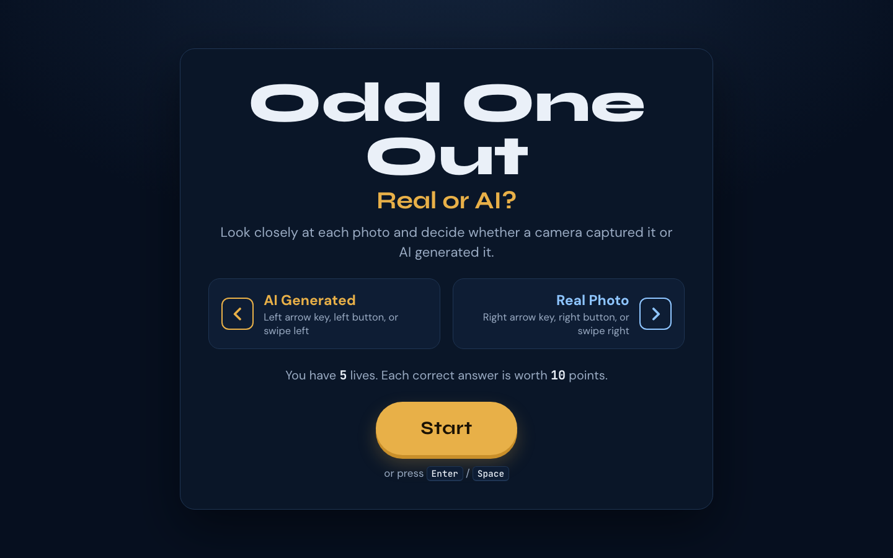

# Odd One Out: Real or AI?

**Live: https://trusty-soul-cdze.here.now/**

A classroom game for AI literacy: each photo is either a real photograph or an AI image, and students swipe or press an arrow key to call it.



**What I built**
- An image pipeline (`build.js`, using sharp) that renames each image to a random hex name, re-encodes it and strips all metadata, so neither filenames nor EXIF give away the answer
- Answers ship encoded and shuffled; alt text never hints
- Keyboard, button and swipe controls, with lives and scoring
- No cookies, storage or analytics

**Stack:** HTML, CSS, vanilla JavaScript, Node + sharp, static hosting on here.now

## Swap in your own images

1. Put real photographs in `source/real/` and AI-generated images in `source/ai/` (jpg, png, or webp).
   Delete the starter images in those folders first if you don't want them in the game.
2. From this folder, run:

   ```
   ./deploy.sh
   ```

   That rebuilds `site/img/` + `site/manifest.js` and republishes to the same URL.
   (`npm run deploy` does the same thing.)

To rebuild without publishing: `node build.js`, then open `site/index.html` in a browser.

## Settings

At the top of `site/game.js`:

- `STARTING_LIVES` (default 5)
- `POINTS_PER_CORRECT` (default 10)
- `FEEDBACK_MS`: how long "Correct!" / "Wrong" stays on screen

## How answers stay hidden

- `build.js` renames every image to a random hex name and re-encodes it to JPEG with all
  metadata stripped (camera EXIF, AI generator tags), so neither the filename, extension,
  nor file info gives the answer away.
- `manifest.js` stores answers base64-encoded and in shuffled order.
- Alt text is always "Photo N".

## Privacy

No login, no cookies, no localStorage, no analytics. The only third-party request is
Google Fonts.

## Files

- `site/`: the published static site (`index.html`, `style.css`, `game.js`, `manifest.js`, `img/`)
- `source/real`, `source/ai`: your image inputs (not published)
- `build.js`: image pipeline (uses `sharp`, installed with `npm install`)
- `deploy.sh`: build + republish to here.now
- `CREDITS.md`: sources for the starter images

## Why the source images aren't here
`source/real/` and `source/ai/` are the answer key, so they stay out of the public repo. Add your own images there and run `node build.js`.
The starter photos are credited in `CREDITS.md`.

## License
Code: MIT (see `LICENSE`). Built by [Brandon Webster](https://campgrnds.com).
